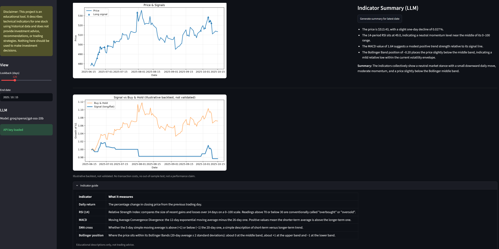

# LLM Investment Insight Generator

> **Disclaimer:** This project is an educational tool. It describes technical indicators for one stock using historical data and does not provide investment advice, recommendations, or trading strategies. Nothing here should be used to make investment decisions.

A small Streamlit dashboard that plots technical indicators for one stock (MSFT) from a static historical snapshot, and uses an LLM (via Groq) to write a short, neutral description of the indicators for the latest date in the selected window.



## What it does

- **Price & signals chart:** MSFT closing price with markers for a rule-based long/flat signal.
- **LLM indicator summary:** on button click, sends price, 1-day return, RSI(14), MACD, Bollinger position and the signal for the latest date to the LLM, and shows 3–5 descriptive bullet points. The prompt tells the model not to give advice or buy/sell/hold suggestions.
- **Signal vs buy & hold chart:** *illustrative backtest, not validated.* It compounds daily returns while the (one-day lagged) signal is long. No transaction costs, no out-of-sample test. It is not a performance claim.
- **Indicator guide:** a collapsed section under the charts explaining each indicator (same table as below).
- **Sidebar controls:** lookback window and end date.

## Indicator guide

| Indicator | What it measures |
|---|---|
| **Daily return** | The percentage change in closing price from the previous trading day. |
| **RSI (14)** | Relative Strength Index: compares the size of recent gains and losses over 14 days on a 0–100 scale. Readings above 70 or below 30 are conventionally called "overbought" or "oversold". |
| **MACD** | Moving Average Convergence Divergence: the 12-day exponential moving average minus the 26-day one. Positive values mean the shorter-term average is above the longer-term one. |
| **SMA cross** | Whether the 5-day simple moving average is above (+1) or below (−1) the 20-day one, a simple description of short-term versus longer-term trend. |
| **Bollinger position** | Where the price sits within its Bollinger Bands (20-day average ± 2 standard deviations): about 0 at the middle band, about +1 at the upper band and −1 at the lower band. |

Educational descriptions only, not trading advice.

## Data

All data is a static snapshot committed to the repo; nothing is fetched at runtime.

| File | Used by app | Contents |
|---|---|---|
| `merged_msft_with_signals.csv` | yes | 125 trading days, 2025-04-17 to 2025-10-15: price, technical indicators, `avg_sentiment`, `composite`, `signal` (31 long, 94 flat, 0 short) |
| `sentiment_features.csv` | no | 4 rows of daily average news sentiment (kept for reference) |

### Where the signal comes from

The signal was generated in an earlier notebook that is not included in this repo. Checking it against the CSV shows how it was built, with one gap:

- `composite = 0.20·z_rsi + 0.25·z_macd + 0.35·z_px_roc` reproduces the stored `composite` column exactly. Each `z_` column is a 60-day rolling z-score of RSI(14), MACD and the 12-day rate of change, respectively.
- The weights add up to 0.80, so a fourth term with weight 0.20 may have been dropped or may have been zero. `sentiment_lag1` is zero on every row, which fits that possibility, but this cannot be confirmed from the data.
- `signal = 1 if composite > 0` matches 103 of the 106 rows that have a composite score. The 3 exceptions are long days with a composite slightly below zero (between −0.024 and −0.002), so the exact threshold or rule used in the notebook cannot be recovered.
- The first 19 rows have no composite score and their signal is 0.

## LLM

- Called through [litellm](https://github.com/BerriAI/litellm).
- Default model: `groq/openai/gpt-oss-20b`. The original model, `llama-3.1-8b-instant`, was retired by Groq on 2026-08-16.
- Any litellm model id can be set with the `LLM_MODEL` environment variable.
- The API key is read from the `GROQ_API_KEY` environment variable or a local `.env` file (see `.env.example`). Without a key, the dashboard still works and the summary button shows a "no API key" message.

## Run locally

Requires Python 3.11 (tested with 3.11.0).

```bash
python -m venv ../.venv-llm-insight
../.venv-llm-insight/Scripts/activate   # Windows; on macOS/Linux: source ../.venv-llm-insight/bin/activate
pip install -r requirements.txt
cp .env.example .env                      # then put your Groq key in .env
streamlit run app.py
```

## Tests

```bash
pip install -r requirements-dev.txt
pytest
```

Two tests: one checks the data file (required columns, sorted unique dates, signal values in {0, 1}, RSI in [0, 100]), and one runs the app headlessly without an API key and checks it renders the disclaimer and the no-key message.

## Limitations

- **Static, single-stock data.** One snapshot of MSFT covering about six months (125 trading days). Not live, not daily-updated. The lookback slider goes to 365 days, but there is no data before 2025-04-17.
- **Pipeline not included.** The notebook that downloaded prices, computed indicators, scored news sentiment and built the signal is not in this repo, so the CSV cannot be regenerated from this code, and the signal rule can only be partly reconstructed (see above).
- **Sentiment is nearly empty.** `avg_sentiment` is non-zero on only 1 of 125 days (2025-10-15, the last day in the data). The column is kept in the CSV but is not charted and not sent to the LLM.
- **Long/flat signals only.** The signal never goes short.
- **Backtest is not validated.** The signal vs buy-and-hold chart is in-sample, ignores costs and slippage, and covers a short window.
- **LLM output is unverified.** The default model has been tested with a live call, but the model can still misdescribe the numbers it is given, and its output is not checked automatically.

## Tech

Streamlit, pandas, NumPy, Matplotlib, litellm, Groq API, python-dotenv.

## License

MIT, see [LICENSE](LICENSE).

## Author

Yigit Uysaloglu
